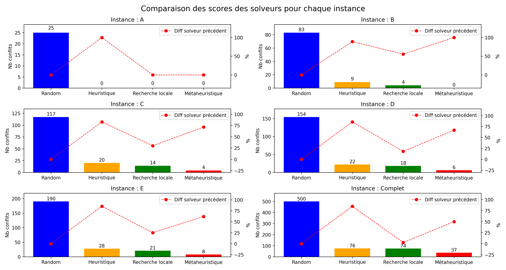
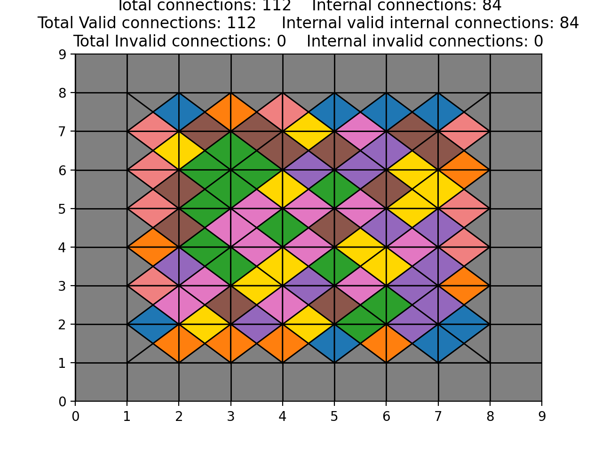
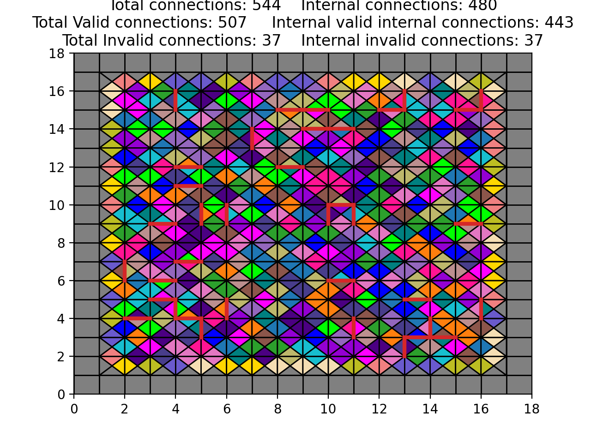

# Eternity II solver: metaheuristics on an unsolved puzzle

Eternity II is a 256-piece edge-matching puzzle (16 × 16) that nobody has ever solved. The goal is to place and rotate every piece so that all neighbouring edges match; since an exhaustive search is out of reach, the solvers minimise the number of conflicts.

This project builds increasingly rich solvers, from a greedy construction to a modular **Large Neighborhood Search (LNS)**, and evaluates them on five reduced instances and on the full puzzle.

Course project, INF6102 Metaheuristics, Polytechnique Montréal, winter 2024.



## Results

Best number of conflicts reached (lower is better):

| Solver | B | C | D | E | Full puzzle |
|---|---|---|---|---|---|
| Greedy | 9 | 20 | 22 | 28 | 76 |
| Local search | 4 | 14 | 18 | 22 | 74 |
| **LNS** | **0** | 4 | 6 | 8 | **37** |

- Instance B is **solved** (0 conflicts), and LNS **halves the conflicts on the full puzzle** (74 → 37).
- In one hour on the full puzzle, local search runs 474 iterations; LNS runs more than 1.5 million.

| Instance B, solved | Full puzzle, 37 conflicts |
|---|---|
|  |  |

## Approach

- **Greedy construction** guided by a conflict heuristic, to get a starting solution.
- **Hill climbing** with restarts and restricted neighbourhoods (about 10 times faster than the full neighbourhood). Simulated annealing was tried and dropped.
- **Large Neighborhood Search**, built as interchangeable parts: 4 destroy functions, 3 repair functions and 4 acceptance criteria that can be combined.
- **Adaptive LNS (ALNS)** with adaptive weights on the destroy and repair operators. It did not beat the tuned LNS, and the report analyses why.
- Parameters calibrated over hundreds of logged runs (15 minutes to 1 hour per instance); the logs are in `logResultats/`. Theoretical and empirical complexity analysis of the LNS.

## Running it

```bash
pip install -r requirements.txt
python main.py --agent=advanced --infile=instances/eternity_B.txt
```

`--agent` is one of `random`, `heuristic`, `local_search` or `advanced` (the LNS).

## Repository layout

| Path | Content |
|---|---|
| `solver_*.py` | One entry point per solver |
| `algoHeuristic.py`, `heuristiques.py` | Greedy construction and conflict heuristics |
| `algoLocalSearch.py` | Neighbourhoods and hill climbing |
| `largeNeighborhoodSearch.py`, `destructFct.py`, `repairFct.py`, `acceptFct.py` | LNS and its interchangeable operators |
| `adaptiveLargeNeighborhoodSearch.py` | Adaptive variant (ALNS) |
| `instances/` | Puzzle instances (reduced A to E, full puzzle) |
| `bestSolutions/` | Best solutions submitted, with their visualisations |
| `savedBestSolutions/`, `logResultats/` | Best solutions found across runs and experiment logs |
| `runTest.py`, `autograder.py` | Experiment runner and scoring script |

## Credits and license

Léo Valette, with Armel Ngounou Tchawe (course team of two).

The solvers and experiment code are released under the [MIT License](LICENSE). The puzzle model (`eternity_puzzle.py`), the command-line entry point (`main.py`) and the instance files come from the INF6102 course framework and are not covered by this license.
